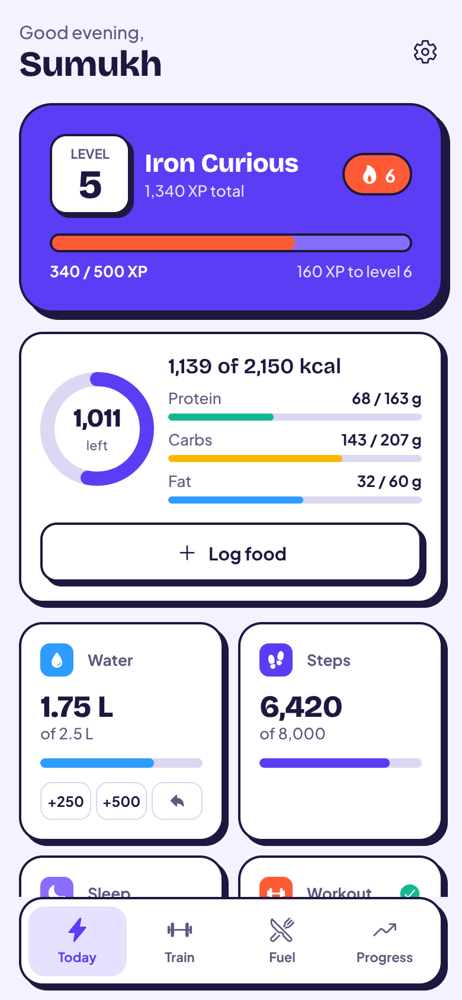
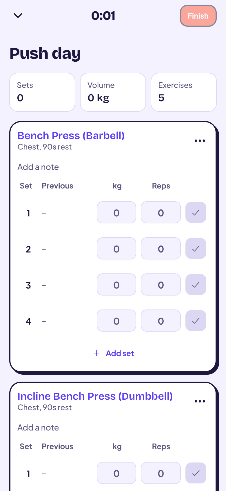
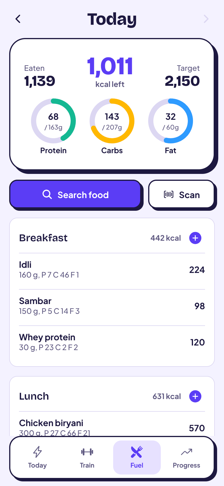
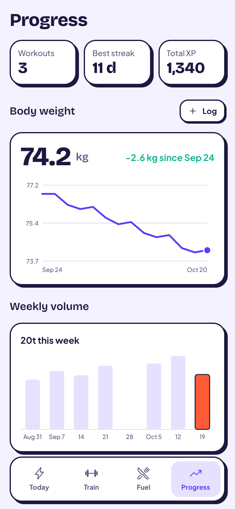

# Shredder

A gamified fitness tracker that combines workout logging (Hevy-style) and nutrition tracking (MyFitnessPal-style) in one app. Every set, meal, glass of water and step goal earns XP toward your next level.

Built with Expo (React Native, SDK 58), Expo Router and Supabase.

<p>
  
  
  
  
</p>

## What works today

**Training**
- Routines with target sets, reps and rest per exercise
- Live workout logger: previous-performance column, warm-up / drop / failure sets, rest timer with haptics, reorder and remove exercises, notes
- The active workout is saved on the device, so a dropped connection or closed app never loses a session
- Server-side PR detection (Epley estimated 1RM) and workout history
- 64-exercise starter library plus custom exercises

**Nutrition**
- Food diary by meal with calorie and macro targets
- 51 common Indian dishes seeded (idli, dosa, biryani, dal, paneer...)
- Packaged food search and barcode scanning through Open Food Facts; scanned products are cached for every user
- Custom foods, serving or gram entry, "log again" from history

**Habits and progress**
- Water quick-add, steps and sleep entry, weigh-ins
- Body-weight trend, weekly training volume, personal-record board

**Gamification**
- XP for workouts, PRs, food logging, protein, water, step and sleep goals, and weigh-ins
- Daily streak with a growing bonus, levels with titles
- All XP is awarded by Postgres functions and triggers; the client can't grant itself points

**Onboarding**
- Goal, body stats and activity level produce calorie, macro and water targets (Mifflin-St Jeor)

## Setup

1. **Create a Supabase project** at [supabase.com](https://supabase.com).
2. **Apply the database schema.** With the [Supabase CLI](https://supabase.com/docs/guides/cli):
   ```sh
   npx supabase login
   npx supabase link --project-ref <your-project-ref>
   npx supabase db push
   ```
   Or paste both files in `supabase/migrations/` (in order) into the SQL editor.
3. **Configure the app.**
   ```sh
   cp .env.example .env
   ```
   Fill in the project URL and publishable key from Project Settings → API.
4. **Run it.**
   ```sh
   npm install
   npx expo start
   ```
   Scan the QR code with Expo Go, or press `w` for the web build.

For quick testing, turn off "Confirm email" under Authentication → Sign In / Providers → Email. Turn it back on before launch.

## Checks

```sh
npm run typecheck   # TypeScript
npm run lint        # ESLint (Expo + React Compiler rules)
npm run test:db     # Runs both migrations in an in-memory Postgres and checks XP, PRs, streaks and RLS
```

## Project structure

```
src/
  app/                  Expo Router screens
    (auth)/welcome      Sign up / sign in
    onboarding          Goal and target setup
    (tabs)/             Today, Train, Fuel, Progress
    workout/            Active logger, exercise picker, workout detail
    routine/edit        Routine builder
    food/               Search, add, barcode scan, custom food
    settings            Goals and account
  components/           UI kit (ink-outlined cards, buttons, rings, charts, sheets)
  constants/theme.ts    Design tokens
  lib/                  Supabase client, data access, XP curve, nutrition maths
  stores/               Zustand stores (session, persisted active workout)
supabase/
  migrations/           Schema, RLS, XP functions and triggers, seed data
  tests/                Database test suite
```

## How XP works

| Action | XP |
| --- | --- |
| Finish a workout | 40, plus 2 per working set (max 60) |
| New personal record | 20 each (max 100 per workout) |
| Log food | 5 per entry, first 6 entries a day |
| Hit protein goal | 20 |
| Hit water goal | 15 |
| Hit step goal | 20 |
| Sleep within 30 min of goal | 15 |
| Weigh in | 5 |
| First activity of the day | 5 × streak days (max 50) |

Reaching level L+1 from level L costs 100 × L XP.

## Roadmap

- **Next:** AI workout planner and snap-a-meal photo logging via Supabase Edge Functions, with a daily cap per user
- Apple Health and Health Connect sync for steps and sleep (needs a development build)
- Exercise detail pages with per-lift charts, superset support, plate calculator
- Social feed (follows, sharing workouts)

## Notes

- Seeded Indian food values are approximations of home-style recipes. Verify them against IFCT 2017 before launch.
- Open Food Facts data is community-contributed and licensed under ODbL; keep the attribution shown on food screens.
- Camera barcode scanning works in Expo Go. Health sync will need `npx expo run:ios|android` or an EAS development build.
